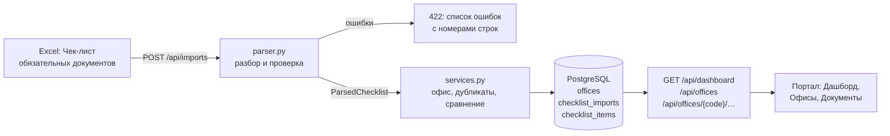
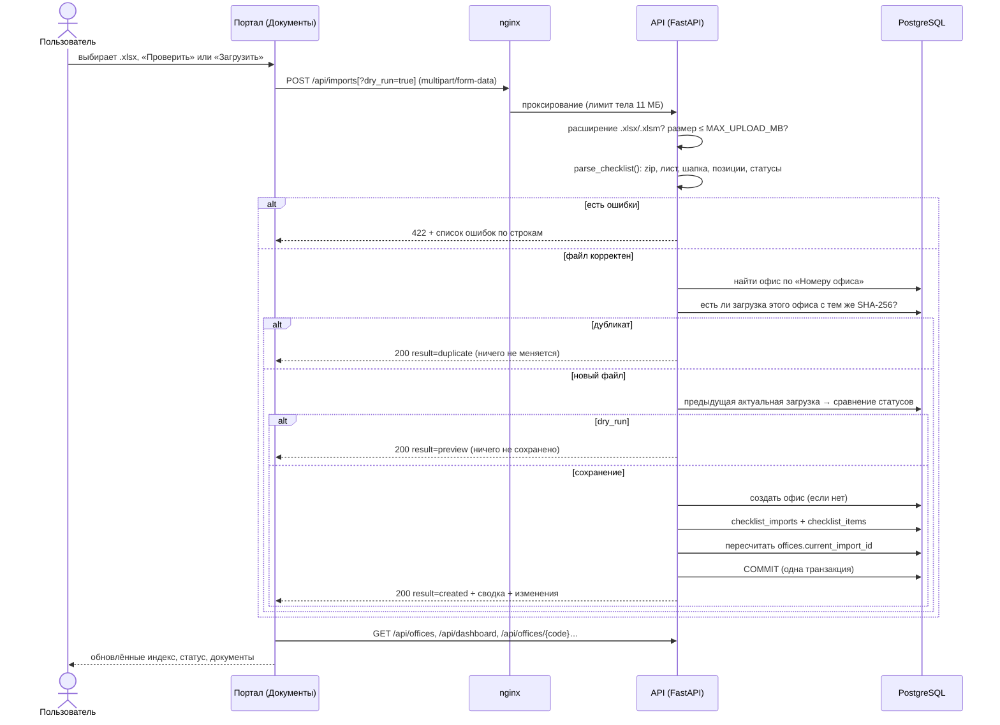
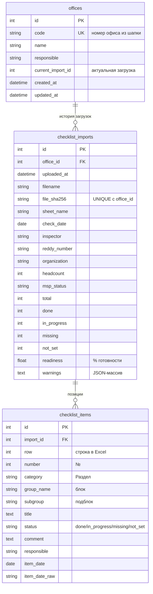

# Загрузка сводной таблицы и связь данных с порталом

Документ описывает полный путь данных: от Excel-файла «Чек-лист обязательных
документов» до показателей на страницах портала. Он предназначен и для
пользователей (как готовить и загружать файл), и для разработчиков (как это
устроено внутри и что можно менять).

Содержание:

1. [Общая схема](#1-общая-схема)
2. [Формат сводной таблицы](#2-формат-сводной-таблицы)
3. [Алгоритм разбора файла](#3-алгоритм-разбора-файла)
4. [Проверки: ошибки и предупреждения](#4-проверки-ошибки-и-предупреждения)
5. [Расчёт показателей](#5-расчёт-показателей)
6. [Процесс загрузки на сервере](#6-процесс-загрузки-на-сервере)
7. [Модель данных](#7-модель-данных)
8. [Связь данных с порталом](#8-связь-данных-с-порталом)
9. [Справочник API](#9-справочник-api)
10. [Типовые сценарии](#10-типовые-сценарии)
11. [Запуск и настройки](#11-запуск-и-настройки)
12. [Безопасность и ограничения](#12-безопасность-и-ограничения)
13. [Как менять шаблон таблицы](#13-как-менять-шаблон-таблицы)

---

## 1. Общая схема



Кратко:

1. Ответственный заполняет шаблон Excel по офису и загружает его на странице
   **«Документы»** портала.
2. Бэкенд разбирает файл, проверяет его и либо возвращает список ошибок, либо
   сохраняет **снимок** чек-листа (загрузку) в БД.
3. Офис определяется по полю **«Номер офиса»** в шапке таблицы. Если такого офиса
   нет, он создаётся автоматически.
4. У каждого офиса есть **актуальная загрузка**: та, у которой самая поздняя дата
   проверки. Из неё портал берёт индекс соответствия, статус офиса и список
   документов.
5. Дашборд считает сводные показатели по актуальным загрузкам всех офисов.

Исходный файл на сервере **не хранится**: в БД сохраняются только
извлечённые данные и SHA-256 файла (для поиска дубликатов).

---

## 2. Формат сводной таблицы

Поддерживается книга Excel **.xlsx** (и .xlsm). Старый формат **.xls** не
поддерживается: такой файл нужно пересохранить как .xlsx.

### 2.1. Листы

| Лист | Используется | Комментарий |
|---|---|---|
| **Чек-лист документов** | **да** | Источник всех данных. Ищется по имени без учёта регистра; если листа с таким именем нет, берётся первый лист книги |
| Сводка по разделам | нет | Формулы Excel. Бэкенд считает те же показатели сам (раздел 5), поэтому значения формул не читаются |
| Инструкция | нет | Справка для заполняющего |

### 2.2. Шапка (строки над таблицей)

Шапка читается по **подписям**, а не по адресам ячеек: ищется ячейка с текстом
подписи (регистр и двоеточие не важны), значение берётся из **следующей
непустой ячейки справа** в той же строке. Если следующая непустая ячейка сама
является подписью (заканчивается на «:»), поле считается незаполненным.

| Подпись в таблице | Поле в БД | Обязательно | Как обрабатывается |
|---|---|---|---|
| Номер офиса: | `offices.code` | **да** | Ключ офиса. Число превращается в текст (`101` → `"101"`). Допустимы буквы, цифры, `.`, `-`, `_`, до 64 символов |
| Дата проверки: | `checklist_imports.check_date` | нет | Дата Excel или текст `ДД.ММ.ГГГГ`, `ДД.ММ.ГГ`, `ГГГГ-ММ-ДД`, `ДД/ММ/ГГГГ`. Если пусто или не распознано, используется дата загрузки (с предупреждением) |
| Проверил: | `inspector` | нет | Текст как есть |
| номер редди: | `reddy_number` | нет | Хранится как текст (длинные числа не теряют точность) |
| Организация: | `organization` | нет | Текст как есть (в текущем шаблоне подписи нет, но поле предусмотрено инструкцией) |
| Численность: | `headcount` | нет | Целое число; если не число, поле пропускается с предупреждением |
| Статус МСП: | `msp_status` | нет | Хранится как текст без интерпретации |

Строка-легенда «Статусы: Есть / В работе / Нет» и прочие подписи игнорируются.

### 2.3. Строка заголовков таблицы

Первая строка, в которой найдены колонки **«№»**, **«Документ / Наименование»**
и **«Статус»**, считается заголовком таблицы. Всё, что выше неё, считается шапкой,
всё, что ниже, телом таблицы.

Колонки определяются **по названию**, поэтому их порядок можно менять:

| Колонка (начало названия, без учёта регистра) | Поле | Обязательна |
|---|---|---|
| `№` | `number` | **да** |
| `Документ…` или `Наименование…` | `title` | **да** |
| `Статус` | `status` | **да** |
| `Раздел` | `category` | нет (если нет, раздел берётся из заголовка блока) |
| `Комментарий…` или `Примечание…` | `comment` | нет |
| `Ответственн…` | `responsible` | нет |
| `Дата…` | `item_date` / `item_date_raw` | нет |

### 2.4. Тело таблицы

Каждая непустая строка ниже заголовка относится к одному из типов:

| Тип строки | Как распознаётся | Пример | Что делает парсер |
|---|---|---|---|
| **Заголовок блока** | в колонке «№» нет числа, заполнена одна ячейка, текст начинается с `N.` | `1. ОХРАНА ТРУДА И СУОТ` | Запоминает блок (`group`), сбрасывает подблок |
| **Подзаголовок** | одна заполненная ячейка, текст начинается с `▸` | `▸ Организационные документы` | Запоминает подблок (`subgroup`) |
| **Позиция** | в колонке «№» целое число | `12 · Охрана труда · Инструкция… · Есть` | Создаёт позицию чек-листа с текущими блоком и подблоком |
| **Конец таблицы** | первая ячейка начинается с `ИТОГО` | `ИТОГО ПО СТАТУСАМ` | Разбор останавливается, всё ниже (итоги, примечания) игнорируется |
| Прочее | всё остальное | пустые строки, пояснения | Пропускается |

### 2.5. Статусы

| В таблице | Код в API/БД | Учитывается в «% готовности» как готовый |
|---|---|---|
| Есть | `done` | да |
| В работе | `in_progress` | нет |
| Нет | `missing` | нет |
| *(пусто)* | `not_set` | нет; позиция учитывается во «Всего», выдаётся предупреждение |

Регистр и лишние пробелы не важны (`  в  РАБОТЕ ` распознаётся как «В работе»).
Любое другое значение (например, «Готово») считается **ошибкой**, и файл не загружается.

---

## 3. Алгоритм разбора файла

Код: `backend/app/parser.py`, функция `parse_checklist(data: bytes)`.

1. **Проверка контейнера.** Файл должен быть zip-архивом (так устроен xlsx).
   Суммарный распакованный размер не больше 50 МБ, частей не больше 2000
   (защита от zip-бомб).
2. **Открытие книги** в режиме `read_only` и `data_only`: читаются значения
   ячеек, а не формулы, книга не загружается в память целиком. Для разбора XML
   используется `defusedxml`, это защита от XXE и «billion laughs».
3. **Выбор листа:** «Чек-лист документов», иначе первый лист.
4. **Построчное чтение** (не больше 5000 строк и 30 колонок):
   - до строки заголовков каждая строка проверяется на подписи шапки (п. 2.2);
   - строка заголовков определяет соответствие колонок (п. 2.3);
   - после неё строки классифицируются по п. 2.4.
5. **Для каждой позиции:**
   - номер: целое число (`12`, `12.0` и `"12"` допустимы);
   - наименование обязательно;
   - номер не должен повторяться;
   - статус нормализуется по п. 2.5;
   - раздел берётся из колонки «Раздел», а если она пуста, из заголовка блока
     без нумерации;
   - дата позиции: если распознана, пишется в `item_date`, иначе исходный текст
     попадает в `item_date_raw` (например, «к концу квартала») с предупреждением.
6. **Проверка шапки:** «Номер офиса» заполнен и корректен.
7. Если найдены **ошибки**, выбрасывается `ChecklistParseError` со **всеми**
   ошибками сразу, чтобы пользователь исправил файл за один раз.
8. Иначе возвращается `ParsedChecklist`: шапка, позиции и предупреждения.

Парсер не зависит от веб-фреймворка и БД, поэтому его можно тестировать и
переиспользовать отдельно.

---

## 4. Проверки: ошибки и предупреждения

**Ошибка** означает, что файл отклонён и ничего не сохранено (HTTP 415/413/422).
**Предупреждение** означает, что файл принят, а замечание показано пользователю
и сохранено вместе с загрузкой.

| Ситуация | Тип | Сообщение (пример) |
|---|---|---|
| Расширение не .xlsx/.xlsm | ошибка 415 | Нужен файл Excel в формате .xlsx |
| Файл больше `MAX_UPLOAD_MB` | ошибка 413 | Файл больше 10 МБ |
| Пустой файл | ошибка 422 | Пустой файл |
| Не zip / старый .xls | ошибка 422 | Файл не является книгой Excel .xlsx… |
| Слишком большой в распакованном виде | ошибка 422 | Файл слишком большой в распакованном виде |
| Повреждённая или зашифрованная книга | ошибка 422 | Не удалось открыть книгу Excel |
| Нет строки заголовков | ошибка 422 | Не найдена строка заголовков таблицы… |
| Не заполнен «Номер офиса» | ошибка 422 | В шапке не заполнен «Номер офиса» |
| Недопустимые символы в номере офиса | ошибка 422 | Недопустимый номер офиса «…» |
| Нет ни одной позиции | ошибка 422 | В таблице не найдено ни одной позиции |
| Пустое наименование | ошибка 422 | Строка 15: у позиции №4 не заполнено наименование документа |
| Повтор номера | ошибка 422 | Строка 20: номер позиции №5 повторяется (уже был в строке 16) |
| Неизвестный статус | ошибка 422 | Строка 11: неизвестный статус «Готово» у позиции №1 (допустимо: Есть / В работе / Нет) |
| Пустой статус | предупреждение | Строка 30: у позиции №19 не указан статус |
| Нераспознанная дата позиции | предупреждение | Строка 31: дату «к концу квартала» не удалось распознать, сохранена как текст |
| Нераспознанная или пустая дата проверки | предупреждение | Дата проверки не указана — будет использована дата загрузки |
| Численность не число | предупреждение | Численность «≈120» не является числом — пропущена |
| Дата проверки раньше актуальной | предупреждение | …файл сохранится в истории, но индекс офиса не изменится |

Номера строк соответствуют номерам строк в Excel.

Формат ответа с ошибками:

```json
{
  "detail": {
    "message": "Файл не прошёл проверку — исправьте ошибки и загрузите снова",
    "errors": [
      "Строка 11: неизвестный статус «Готово» у позиции №1 (допустимо: Есть / В работе / Нет)"
    ]
  }
}
```

---

## 5. Расчёт показателей

Расчёт повторяет формулы листа «Сводка по разделам» шаблона.

| Показатель | Формула | Аналог в Excel |
|---|---|---|
| Всего позиций (по разделу) | число позиций с этим разделом | `COUNTIF(B:B; раздел)` |
| Есть / В работе / Нет | число позиций раздела с этим статусом | `COUNTIFS(B:B; раздел; D:D; статус)` |
| **% готовности** | `Есть / Всего × 100`, округление до 0,1 | `IF(B=0;0;C/B)` |
| ИТОГО | суммы по всем разделам | `SUM(...)` |

Позиции с пустым статусом входят во «Всего», но не в «Есть», поэтому снижают %
готовности так же, как в Excel. В таблицах портала они показаны в колонке «Нет».

**Индекс соответствия офиса** равен % готовности его актуальной загрузки.

**Статус (уровень) офиса** определяется по индексу:

| Уровень | Код | Условие (по умолчанию) | Настройка |
|---|---|---|---|
| Хорошо | `good` | индекс ≥ 90 % | `READINESS_GOOD` |
| Требует внимания | `warn` | 70 % ≤ индекс < 90 % | `READINESS_WARN` |
| Критично | `bad` | индекс < 70 % | — |
| Нет данных | `new` | загрузок нет | — |

**Дашборд** (`GET /api/dashboard`, все показатели — по актуальным загрузкам офисов):

| Показатель | Как считается |
|---|---|
| Индекс соответствия (средний) | Среднее арифметическое индексов офисов, у которых есть данные, без взвешивания по числу позиций |
| Офисы по уровням | Число офисов в каждом уровне по их индексу; офисы без загрузок — «Нет данных» |
| Документы Есть / В работе / Нет | Суммы позиций по актуальным загрузкам всех офисов (пустой статус учитывается в «Нет») |
| Проседающие направления | Число пар «офис × направление», у которых % готовности ниже порога «Хорошо» (`READINESS_GOOD`) |
| **Ячейка тепловой карты** | Для офиса и направления: `Есть / Всего × 100` по позициям этого направления в актуальной загрузке офиса; цвет — уровень по тем же порогам. «—» — у офиса нет позиций в этом направлении |
| Заголовок колонки карты | % готовности направления по всем офисам вместе (позиции суммируются) |
| Порядок строк карты | По умолчанию — по индексу офиса по возрастанию (худшие сверху); клик по направлению — по % этого направления |
| Динамика (▲/▼ у индекса) | Индекс актуальной проверки минус индекс предыдущей (по дате проверки) у того же офиса; нет предыдущей — не показывается |
| Слабые места | Все пары «офис × направление» ниже порога «Хорошо», сортировка по % по возрастанию, при равенстве — по числу «Нет» |
| Чаще всего отсутствует | Документы со статусом «Нет» (или пустым) в актуальных загрузках; документы разных офисов сопоставляются по наименованию (без учёта регистра и пробелов); сортировка по числу офисов, где документа нет; доля = офисов без документа / офисов с данными |
| Готовность по направлениям | Позиции всех актуальных загрузок суммируются по направлению, затем `Есть / Всего × 100`; на графике — от худшего направления к лучшему |

Как пользоваться дашбордом:

1. Сверху — общая картина: средний индекс, сколько офисов в каждом уровне,
   сколько документов отсутствует, сколько направлений проседает.
2. **Тепловая карта «офис × направление»** отвечает на вопрос «где и что
   проседает»: красные ячейки — направление ниже 70 %, жёлтые — ниже 90 %.
   Наведение на ячейку показывает раскладку Есть / В работе / Нет.
   Переключатель «Нет, шт.» показывает в ячейках число отсутствующих документов
   вместо процента; флажок «только с проблемами» скрывает офисы, где всё в норме.
3. **Клик по ячейке** (или по пункту «Слабые места») открывает страницу
   «Документы» этого офиса с фильтром по направлению и прокручивает к
   чек-листу. Клик по коду офиса в строке карты — документы офиса без фильтра.
   Клик по коду офиса в блоке «Чаще всего отсутствует» — документы этого офиса по
   направлению с фильтром «Нет».
4. «Готовность по направлениям» переключается в таблицу (те же цифры, что на
   листе «Сводка по разделам», но по всем офисам).

**Пример.** Таблица из 81 позиции: Есть 45, В работе 22, Нет 14.
Индекс = 45 / 81 = **55,6 %**, уровень «Критично». По разделам:

| Раздел | Всего | Есть | В работе | Нет | % |
|---|---|---|---|---|---|
| Охрана труда | 45 | 19 | 16 | 10 | 42,2 |
| Первая помощь | 6 | 6 | 0 | 0 | 100,0 |
| Пожарная безопасность | 15 | 9 | 6 | 0 | 60,0 |
| ГО и ЧС | 11 | 11 | 0 | 0 | 100,0 |
| Аренда / Электр. | 4 | 0 | 0 | 4 | 0,0 |
| **ИТОГО** | **81** | **45** | **22** | **14** | **55,6** |

---

## 6. Процесс загрузки на сервере

Код: `backend/app/main.py` (`POST /api/imports`) → `services.import_checklist()`.



Шаги подробно:

1. **Приём файла.** Проверяется расширение, затем файл читается в память, но не
   больше `MAX_UPLOAD_MB + 1` байт. Если файл длиннее, возвращается 413. На
   диск файл не пишется.
2. **Разбор и проверка** по разделам 3 и 4.
3. **Определение офиса** по `office_code`. Если офиса нет, он будет создан с
   названием, равным номеру. Название и ответственного потом можно поменять на
   странице «Офисы».
4. **Поиск дубликата.** Считается SHA-256 файла. Если у этого офиса уже есть
   загрузка с таким же хэшем, возвращается `result: "duplicate"` и ничего не
   сохраняется. Ограничение `UNIQUE(office_id, file_sha256)` в БД защищает от
   двойной загрузки и при гонке запросов.
5. **Сравнение с предыдущей проверкой.** Позиции сопоставляются по
   **наименованию** документа (без учёта регистра и лишних пробелов), а не по
   номеру, потому что номера сдвигаются при добавлении строк. В ответе:
   - `changed`: документы, у которых сменился статус, с направлением
     `better`/`worse`; порядок «улучшения»: Нет/не указан → В работе → Есть;
   - `added`: номера новых позиций;
   - `removed`: позиции, которых больше нет в чек-листе.
6. **Режим предпросмотра** (`dry_run=true`): возвращается всё то же самое
   (сводка, предупреждения, изменения), но в БД ничего не пишется. На портале это
   кнопка **«Проверить»**.
7. **Сохранение** в одной транзакции: офис (если новый), запись
   `checklist_imports` с шапкой и итогами, все `checklist_items`.
8. **Выбор актуальной загрузки** офиса: самая поздняя `check_date`, при равных
   датах последняя загруженная (наибольший `id`). Поэтому:
   - новая проверка становится актуальной, и индекс офиса меняется;
   - файл с **более ранней** датой проверки (например, архив) попадает только в
     историю, индекс не меняется, пользователь получает предупреждение;
   - повторная загрузка исправленного файла с той же датой заменяет актуальную.
9. **Ответ** содержит итог (`summary`), сводку по разделам (`by_category`),
   предупреждения, изменения, карточку офиса и признак `is_current`.
10. **Обновление портала.** После успешной загрузки фронтенд перезапрашивает
    список офисов, дашборд и данные выбранного офиса, и новые показатели сразу
    видны на всех страницах.

Удаление ошибочной загрузки (`DELETE /api/imports/{id}`) удаляет её вместе с
позициями и снова выбирает актуальную загрузку офиса. Если удалили актуальную,
актуальной становится предыдущая по дате проверки.

---

## 7. Модель данных

Код: `backend/app/models.py`. Таблицы создаются автоматически при старте
бэкенда (`create_all`).



Проектные решения:

- **Загрузка — неизменяемый снимок.** Повторная проверка не перезаписывает
  старые данные, а добавляет новую загрузку. Так сохраняется история и можно
  посмотреть динамику.
- **Итоги денормализованы** в `checklist_imports` (`total`, `done`, …,
  `readiness`), поэтому список офисов и дашборд не пересчитывают позиции при
  каждом запросе.
- `current_import_id` хранится без внешнего ключа, чтобы не было циклической
  зависимости таблиц. Его согласованность поддерживает
  `services.refresh_current_import()`, который вызывается при каждой загрузке и
  удалении.
- Удаление каскадное: офис → загрузки → позиции (`ON DELETE CASCADE`; для
  SQLite включается `PRAGMA foreign_keys=ON`).

---

## 8. Связь данных с порталом

Фронтенд обращается к API через `src/api.js`. Все запросы идут на тот же домен
по пути `/api/…`: в разработке их проксирует Vite (`vite.config.js`), в Docker
nginx (`nginx.conf`). Поэтому CORS не нужен.

### 8.1. Какая страница что запрашивает

| Страница портала | Запросы | Что показывается |
|---|---|---|
| При входе | `GET /api/config` | Пороги уровней для цветных индикаторов |
| **Дашборд** | `GET /api/dashboard` | KPI (средний индекс, офисы по уровням, документы Есть/В работе/Нет, число проседающих направлений); **тепловая карта «офис × направление»** с переходом по клику в документы офиса по направлению; слабые места; документы, которых чаще всего нет; готовность по направлениям по всем офисам; динамика офиса к прошлой проверке |
| **Офисы** | `GET /api/offices` | Таблица: номер и название, ответственный, индекс, дата проверки, уровень |
| Офисы → «+ Создать офис» | `POST /api/offices` | Ручное создание офиса до первой загрузки |
| Офисы → «Назначить» | `PATCH /api/offices/{code}` | Смена ответственного |
| Офисы → «Документы» | переход на страницу «Документы» с выбранным офисом | |
| Дашборд → ячейка карты / слабое место / код офиса | переход на «Документы»: `GET /api/offices/{code}/checklist?category=…[&status=missing]` | Чек-лист офиса, уже отфильтрованный по направлению (и статусу) |
| **Документы → Загрузка** | `POST /api/imports?dry_run=true` («Проверить»), `POST /api/imports` («Загрузить») | Результат: офис, дата, сводка по разделам, предупреждения или ошибки, изменения относительно прошлой проверки |
| **Документы → офис** | `GET /api/offices/{code}`, `GET /api/offices/{code}/imports`, `GET /api/offices/{code}/checklist?status=&category=&q=` | Карточка офиса (индекс, уровень, шапка проверки), сводка по разделам, чек-лист с группировкой по блокам и фильтрами, история загрузок |
| Документы → история → «Удалить» | `DELETE /api/imports/{id}` | Удаление ошибочной загрузки (только роль «Супер-админ» в интерфейсе) |

После любого изменения (загрузка, удаление, создание офиса, назначение)
фронтенд заново запрашивает `/api/offices` и `/api/dashboard`, поэтому все
страницы показывают согласованные данные.

### 8.2. Соответствие полей

| На портале | Поле API | Источник в Excel |
|---|---|---|
| Номер офиса | `office.code` | Шапка «Номер офиса:» |
| Индекс соответствия | `readiness` | Есть / Всего, лист «Чек-лист документов» |
| Статус офиса | `level`, `level_label` | По индексу и порогам |
| Дата проверки | `check_date` | Шапка «Дата проверки:» |
| Проверил | `current_import.inspector` | Шапка «Проверил:» |
| Численность / Номер редди / Статус МСП | `current_import.headcount` / `reddy_number` / `msp_status` | Шапка |
| Раздел | `items[].category` | Колонка «Раздел» |
| Блок / подблок | `items[].group` / `subgroup` | Строки «1. …» и «▸ …» |
| Документ | `items[].title` | Колонка «Документ / Наименование» |
| Статус документа | `items[].status`, `status_label` | Колонка «Статус» |
| Комментарий, Ответственный, Дата | `items[].comment`, `responsible`, `date` или `date_raw` | Одноимённые колонки |

### 8.3. Как подключить другие разделы портала

Разделы «СОУТ», «Пожарная безопасность», «Электробезопасность», «ГО ЧС» пока
заглушки. Данные для них уже есть: нужно запросить чек-лист с фильтром по
разделу, например:

```
GET /api/offices/{code}/checklist?category=Пожарная безопасность
```

Для СОУТ подходит поиск по наименованию: `?q=СОУТ`.

---

## 9. Справочник API

Интерактивная документация (Swagger UI) доступна по адресу **`/api/docs`**,
схема OpenAPI по адресу `/api/openapi.json`.

### `POST /api/imports`

Загрузка сводной таблицы.

- Тело: `multipart/form-data`, поле `file` (.xlsx/.xlsm).
- Query: `dry_run=true` означает только проверку и предпросмотр.
- Ответы: `200` (`result`: `created` | `preview` | `duplicate`), `413`, `415`, `422`.

```bash
# Проверить, ничего не сохраняя
curl -F "file=@checklist.xlsx" "http://localhost:8080/api/imports?dry_run=true"
# Загрузить
curl -F "file=@checklist.xlsx" http://localhost:8080/api/imports
```

Пример ответа (`result: created`, сокращено):

```json
{
  "result": "created",
  "message": "Создан офис «A1», загружено позиций: 81, готовность 55.6%",
  "office_created": true,
  "is_current": true,
  "office": {
    "code": "A1", "name": "A1", "responsible": null,
    "readiness": 55.6, "level": "bad", "level_label": "Критично",
    "check_date": "2026-08-17", "counts": {"total": 81, "done": 45, "in_progress": 22, "missing": 14, "not_set": 0}
  },
  "import": {"id": 1, "check_date": "2026-08-17", "inspector": "…", "headcount": 120, "readiness": 55.6, "…": "…"},
  "summary": {"total": 81, "done": 45, "in_progress": 22, "missing": 14, "not_set": 0, "readiness": 55.6},
  "by_category": [
    {"category": "Охрана труда", "total": 45, "done": 19, "in_progress": 16, "missing": 10, "not_set": 0, "readiness": 42.2}
  ],
  "warnings": [],
  "changes": {"has_previous": false, "changed": [], "improved": 0, "worsened": 0, "added": [], "removed": []}
}
```

### `GET /api/imports/{id}`

Загрузка целиком: шапка (`import`), `is_current`, `by_category`, `items`.

### `DELETE /api/imports/{id}`

Удаляет загрузку и пересчитывает актуальную. Ответ: `{"deleted": id, "office": {...}}`.

### `GET /api/offices`

Список офисов, отсортированный по номеру. Для каждого офиса: `code`, `name`,
`responsible`, `readiness`, `level`, `level_label`, `check_date`, `inspector`,
`headcount`, `counts`, `current_import_id`, `last_uploaded_at`. У офиса без
загрузок поля индекса равны `null`, а `level` равен `"new"`.

### `POST /api/offices`

`{"code": "cy2", "name": "…", "responsible": "…"}` → `201`; `409`, если офис уже есть.

### `PATCH /api/offices/{code}`

`{"name": "…"}` и/или `{"responsible": "…"}`. Пустая строка или `null` в
`responsible` снимает ответственного.

### `GET /api/offices/{code}`

Карточка офиса: поля из списка, плюс `current_import` (шапка актуальной
проверки) и `by_category`.

### `GET /api/offices/{code}/checklist`

Позиции актуальной загрузки. Фильтры:
`status` (`done`/`in_progress`/`missing`/`not_set`), `category` (точное название
раздела), `q` (подстрока наименования без учёта регистра). Фильтры можно
сочетать.

### `GET /api/offices/{code}/imports`

История загрузок офиса (новые сверху) с признаком `is_current`.

### `GET /api/dashboard`

```json
{
  "offices_total": 3, "offices_with_data": 2,
  "avg_readiness": 72.4, "avg_level": "warn",
  "levels": {"good": 1, "warn": 0, "bad": 1, "new": 1},
  "documents": {"total": 162, "done": 117, "in_progress": 30, "missing": 15, "not_set": 0, "readiness": 72.2},
  "by_category": [ {"category": "Охрана труда", "…": "…"} ],
  "last_uploaded_at": "2026-11-19T08:40:00+00:00"
}
```

Дополнительные поля дашборда:

| Поле | Содержимое |
|---|---|
| `categories` | Направления (разделы) в порядке шаблона — колонки тепловой карты |
| `matrix[]` | Офисы с данными (худшие первыми): `code`, `name`, `readiness`, `level`, `check_date`, `counts`, `prev_readiness` и `delta` (к предыдущей проверке), `cells{направление: {total, done, in_progress, missing, not_set, readiness, level}}` |
| `by_category[]` | Сводка по направлению по всем офисам + `offices`, `offices_avg` (средняя по офисам), `offices_below_good`, `level` |
| `weak_spots[]` | До 20 пар «офис × направление» ниже порога «Хорошо», от худших; `weak_spots_total` — сколько всего |
| `top_missing[]` | До 10 документов, чаще всего отсутствующих: `title`, `category`, `offices[]`, `count`, `share` (% офисов); `top_missing_total` |
| `thresholds` | Пороги уровней `{good, warn}` |

Документы в `top_missing` сопоставляются между офисами по наименованию (как и при сравнении проверок).

### `GET /api/config`, `GET /api/health`

Подписи статусов и уровней, пороги, лимит размера файла; проверка
работоспособности.

---

## 10. Типовые сценарии

| Сценарий | Что происходит |
|---|---|
| **Первая загрузка по офису** | Офис создаётся автоматически, загрузка становится актуальной, офис появляется в списке и на дашборде |
| **Офис заведён вручную, потом загружен файл** | Файл привязывается к существующему офису по номеру; название и ответственный сохраняются |
| **Повторная проверка (новая дата)** | Новая загрузка становится актуальной, в ответе показано, какие документы изменили статус |
| **Исправили ошибку в файле, дата та же** | Новая загрузка становится актуальной (при равной дате выигрывает последняя). Старую можно удалить из истории |
| **Загрузили старый файл (дата раньше)** | Сохраняется в историю, индекс не меняется, выдаётся предупреждение |
| **Тот же файл ещё раз** | `duplicate`, ничего не меняется |
| **В файле ошибки** | 422 со списком всех ошибок и номерами строк, ничего не сохраняется |
| **Загрузили не тот файл** | Удалить загрузку в истории (роль «Супер-админ»), актуальная пересчитается |
| **Нужно понять, где проседает направление** | Дашборд → тепловая карта → клик по заголовку направления (офисы отсортируются по нему) → клик по красной ячейке → список документов офиса по этому направлению |

---

## 11. Запуск и настройки

### Docker (всё вместе)

```bash
cp .env.example .env          # задать пароль БД
docker compose up -d --build
```

- Портал: http://localhost:8080
- API через портал: http://localhost:8080/api/…; Swagger: http://localhost:8080/api/docs
- Бэкенд наружу не публикуется, доступ к нему идёт только через nginx портала.
- Данные БД хранятся в томе `pgdata`.

### Локальная разработка

**macOS, одной кнопкой:** двойной клик по `start-dev.command` в корне
репозитория (или `./start-dev.command` в терминале). Скрипт находит Python 3.10+,
создаёт `backend/.venv`, ставит зависимости, запускает бэкенд (:8000) и фронтенд
(:5173) и открывает портал в браузере. Остановка — Ctrl+C или закрыть окно
Терминала. Код подхватывается на лету: после `git pull` перезапуск не нужен
(если не менялись зависимости).

Вручную:

```bash
# бэкенд (SQLite в backend/data/portal.db)
cd backend
python -m venv .venv && . .venv/bin/activate
pip install -r requirements-dev.txt
uvicorn app.main:app --reload --port 8000

# фронтенд (в другом терминале, из корня репозитория)
npm install
npm run dev     # http://localhost:5173, /api проксируется на :8000
```

Тесты бэкенда: `cd backend && pytest`. Для тестов таблица генерируется
синтетически (`tests/factory.py`), реальные файлы офисов в репозиторий не
кладутся.

### Переменные окружения бэкенда

| Переменная | По умолчанию | Назначение |
|---|---|---|
| `DATABASE_URL` | `sqlite:///./data/portal.db` | Строка подключения. В Docker: `postgresql+psycopg://…@db:5432/…` |
| `MAX_UPLOAD_MB` | `10` | Максимальный размер файла. В `nginx.conf` лимит `client_max_body_size 11m`; если поднимаете лимит, увеличьте и его |
| `READINESS_GOOD` | `90` | Порог уровня «Хорошо», % |
| `READINESS_WARN` | `70` | Порог уровня «Требует внимания», % |
| `CORS_ORIGINS` | пусто | Список источников через запятую, если фронтенд размещён на другом домене |

---

## 12. Безопасность и ограничения

**Что уже сделано:**

- лимит размера файла на уровне nginx и приложения;
- проверка, что файл является zip-архивом, ограничение распакованного размера
  и числа частей (zip-бомбы);
- безопасный разбор XML через `defusedxml` (XXE, «billion laughs»);
- чтение в режиме `read_only`, ограничение по строкам и колонкам;
- формулы и макросы не выполняются, читаются только сохранённые значения;
- исходный файл не сохраняется ни на диск, ни в БД;
- бэкенд-контейнер работает от непривилегированного пользователя и не
  публикует порт наружу;
- пароль БД хранится в `.env`, файл не попадает в git.

**Что важно знать:**

- ⚠️ **Аутентификации и авторизации в API пока нет.** Роли на портале
  переключаются кнопкой в браузере, сервер их не проверяет. До интеграции с
  Active Directory портал можно использовать только во внутренней сети и
  **нельзя публиковать в интернет**. Удаление загрузок скрыто от роли
  «Ответственный офиса» только в интерфейсе.
- В БД попадают ФИО (проверяющий, ответственные) — это персональные данные;
  учитывайте это при резервном копировании и доступе к БД.
- Схема БД создаётся через `create_all`: она создаёт новые таблицы, но **не
  изменяет существующие**. При изменении моделей нужны миграции (рекомендуется
  Alembic).
- Поддерживается один шаблон таблицы (этот документ). Другие шаблоны потребуют
  доработки парсера.

---

## 13. Как менять шаблон таблицы

**Можно без изменений в коде:**

- добавлять, удалять и переставлять позиции, блоки (`N. …`) и подблоки (`▸ …`);
- добавлять новые разделы в колонке «Раздел»: они автоматически появятся в
  сводке и фильтрах;
- менять порядок колонок, добавлять свои колонки (лишние игнорируются);
- двигать шапку: поля ищутся по подписям;
- переименовать лист (тогда должен быть первым в книге).

**Требует доработки парсера** (`backend/app/parser.py`):

- новые статусы: добавить в `_STATUS_ALIASES` и `STATUS_LABELS`, решить, как
  они учитываются в % готовности, обновить фронтенд (`STATUS_LABEL` и
  `STATUS_BADGE` в `src/api.js`);
- новые поля шапки: добавить подпись в `_META_LABELS`, поле в модель
  `ChecklistImport` и в `import_to_dict` (плюс миграция БД);
- переименование обязательных колонок («№», «Документ», «Статус») или подписи
  «Номер офиса»;
- если ниже таблицы появятся строки, которые не начинаются с «ИТОГО», но
  содержат число в колонке «№», они будут прочитаны как позиции.

После изменения шаблона обновите генератор `backend/tests/factory.py` и
прогоните тесты.
